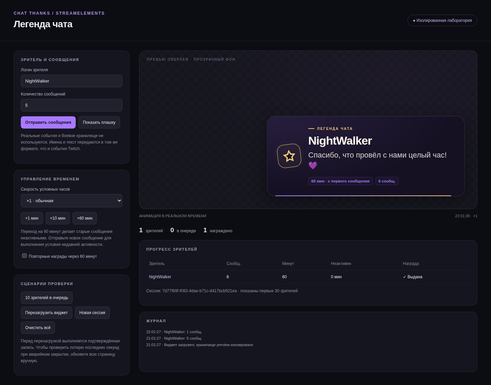

# Легенда чата — благодарности зрителям Twitch

Готовые исходники StreamElements Custom Widget для OBS Studio: Vanilla JavaScript, прозрачная анимированная плашка, очередь, сохранение прогресса и изолированное локальное превью. Свой сервер и библиотеки для работы виджета не нужны. Для аватарок используется публичный DecAPI; при недоступности сети отображается печать.

По умолчанию благодарность появляется, когда с первого сообщения зрителя прошло **60 минут**, накоплено **5 сообщений**, а последнее сообщение было **не более 10 минут назад**. Условия проверяются после сообщения и каждые 15 секунд. Одному зрителю полагается одна награда за сессию.

**Это время с первого сообщения, а не подтверждённый watchtime.** Пять сообщений в начале и новое сообщение через час удовлетворяют условиям. Увидеть, смотрел ли зритель видео всё это время, этот API не позволяет. Текст «целый час» — декоративный шаблон: при изменении порога рекомендуется заменить его на «Спасибо за {minutes} минут с первого сообщения! 💜».



## Оформление дунхуа

Новая фэнтезийная тема: нефритовый меч и лотос, орбитальная печать, золотые уголки, облачные орнаменты и тушевые горы. Тема встроена в HTML/CSS и автоматически приходит через полный загрузчик. [Превью плашки](docs/DONGHUA.png) · [Описание и настройки](docs/DONGHUA.md).

## Установка

1. Откройте [StreamElements](https://streamelements.com/) → Streaming tools → Overlays → создайте или откройте оверлей 1920×1080.
2. Добавьте Static / Custom → Custom Widget и откройте редактор кода (названия меню могут меняться).
3. Скопируйте **содержимое** файлов в одноимённые вкладки:

   | Файл | Вкладка |
   | --- | --- |
   | `widget/HTML.html` | HTML |
   | `widget/CSS.css` | CSS |
   | `widget/JS.js` | JS |
   | `widget/FIELDS.json` | FIELDS |
   | `widget/DATA.json` | DATA при первоначальной установке |

4. `DATA.json` содержит начальные значения FIELDS, **не прогресс зрителей**. Не вставляйте его повторно поверх настроенного виджета: он заменит настройки. В редакторе без вкладки DATA используйте значения по умолчанию из FIELDS.
5. Растяните Custom Widget на весь оверлей 1920×1080: положение плашки отсчитывается внутри него. Сохраните изменения.
6. В OBS добавьте источник «Браузер», вставьте URL оверлея, задайте 1920×1080. При поддержке источником установите 60 FPS; фон оставьте прозрачным.
7. Для непрерывного учёта выключите «Отключать источник, когда он не виден» и «Обновлять браузер при переключении на сцену». Используйте один общий источник в сценах через «Добавить существующий».
8. Выключите тестовый режим, оставьте роль «Активный». Убедитесь, что нет второго открытого активного экземпляра, включая редактор StreamElements. Для проверки в редакторе сначала временно закройте/отключите источник OBS.

Подробные действия, настройка звука и ручная проверка: [Установка](docs/INSTALLATION.md).

## Автоматическое обновление оформления и логики

Чтобы будущие правки приходили из GitHub, установите во вкладку **JS** содержимое [widget/AUTOUPDATE.js](widget/AUTOUPDATE.js) вместо обычного `JS.js`, а вкладки **HTML и CSS очистите**. Существующие FIELDS, DATA и свои настройки оставьте. Сохраните и обновите оверлей. Старый загрузчик нужно один раз заменить вручную.

Загрузчик получает **HTML, CSS и JS вместе из одного коммита**, проверяет обновления каждые 5 минут и ждёт завершения очереди перед установкой. Сессия и прогресс передаются новой версии. Правка только оформления тоже применяется автоматически. При ошибке возвращается прежний комплект; без сети доступна полная последняя рабочая локальная копия, если она сохранена. FIELDS и сам загрузчик автоматически не заменяются.

Первый запуск и разрешение сетевой/Blob-загрузки нужно проверить в StreamElements. [Порядок установки, проверка и ограничения](docs/AUTOUPDATE.md).

## Аватарки зрителей

Вместо печати по умолчанию показывается круглая Twitch-аватарка получателя благодарности. Рамка и задержка сохраняются; при ошибке возвращается печать. В новом FIELDS доступен переключатель аватарок. Для теста задайте настоящий Twitch-логин в «Имя тестового зрителя», например `xelennum`. [Инструкция, внешний источник и ограничения](docs/AVATARS.md).

## Настройки размеров, заголовка и эмблемы

Доступны независимые размеры заголовка «ЛЕГЕНДА ЧАТА», имени зрителя и фразы благодарности, отдельный выбор шрифта заголовка и задержка появления эмблемы. По умолчанию она начинается через 0,25 с после завершения выезда плашки. При полном AUTOUPDATE.js код и оформление приходят автоматически; для новых контролов **один раз обновите FIELDS** из `widget/FIELDS.json`, сохраните и обновите оверлей. Текущий DATA не заменяйте — ваши значения и прогресс нужно сохранить.

## Настройка условий и оформления

Все рабочие параметры находятся в FIELDS; менять JS не требуется. Есть цвета, ширина, шрифт, положение, частицы, длительность переходов и показа, звук, пороги, очередь и хранение. Шаблоны заголовка и текста: `{displayName}`, `{minutes}`, `{messages}`. Имена выводятся как текст, HTML не исполняется.

Начальные параметры: 60 минут / 5 сообщений / 10 минут недавней активности, показ 7 секунд плюс появление 0,65 и исчезновение 0,55 секунды. Пауза между плашками — 1 секунда. Встроенный список известных ботов можно отключить; собственные исключения задаются логинами или Twitch ID.

Полная таблица: [Настройки](docs/SETTINGS.md). Изменения применяются при загрузке/перезагрузке виджета. Изменение обычных FIELDS не сбрасывает сессию. Изменение `storageNamespace` выбирает другое хранилище, `resetToken` намеренно начинает новую сессию.

## Локальное превью и проверки

Из каталога проекта:

```sh
python3 -m http.server 8080 --bind 127.0.0.1
```

Откройте <http://127.0.0.1:8080/preview/>. Не открывайте HTML через `file://`: браузер может блокировать загрузку соседних файлов.

Кнопки позволяют отправлять сообщения, добавлять условные минуты, менять скорость часов, создавать десять зрителей, проверять очередь, повторные награды, перезагрузку и сброс. Анимации идут в реальном времени. Превью использует собственный эмулятор SE_API на localStorage с ключами `PreviewOnly`; боевое хранилище не затрагивается.

Быстрая проверка: отправьте 5 сообщений → награды нет; нажмите `+60 мин` → награды нет из-за неактивности; отправьте ещё одно сообщение → появляется плашка. Кнопка «Перезагрузить виджет» подтверждает запись перед загрузкой; обновление всей страницы имитирует закрытие без принудительной записи.

Для тестов основной логики нужен Node.js 18+; установка пакетов не требуется:

```sh
npm test
```

Браузерные тесты требуют только инструмент разработки Playwright и Chromium. При работающем HTTP-сервере:

```sh
npm ci
npx playwright install chromium
npm run test:browser
```

Для уже установленного Chromium можно пропустить его скачивание:

```sh
CHROMIUM_PATH=/usr/bin/chromium npm run test:browser
```

Тест создаёт `test-results/preview.png`. Playwright не входит в код виджета.

## Сохранение, перезапуск и сброс

Основное хранилище — документированный `SE_API.store`. Оно общее для аккаунта StreamElements, поэтому назначьте собственное буквенно-цифровое имя хранилища для каждого независимого канала/виджета. Сохраняются версия схемы, сессия, пользователи, счётчики, временные отметки, награды и очередь. Сообщения и их текст не сохраняются.

Запись объединяется: обычно не чаще раза в 15 секунд, а также при загрузке, начале награды и сбросе. При закрытии делается попытка записи, но браузер не гарантирует завершение асинхронной операции. Аварийное закрытие может потерять последние секунды несохранённого прогресса. Уже начатая награда фиксируется до показа; если процесс закрыт между фиксацией и анимацией, показ будет пропущен, чтобы избежать повторов.

После обновления или перезапуска OBS восстанавливается та же действующая сессия. По умолчанию она сбрасывается после 6 часов без учитываемых сообщений. Альтернатива — ручной режим и кнопка сброса перед новым стримом. Достоверного события начала/конца Twitch-эфира в использованных API нет: автоопределение эфира не заявляется. Сообщения, пока виджет выключен, не восстанавливаются.

Для безопасного сброса закройте дополнительные экземпляры, убедитесь, что сохранение включено, нажмите «Сбросить сессию сейчас», дождитесь подтверждённой записи/перезагрузки. Начнётся новая сессия и очередь очистится. «Очистить зрителей и сохранённые данные» также заменяет текущий снимок пустой сессией. Это необратимо. Ключ SE_API физически удалить нельзя — API этого не поддерживает. Локальный резерв этого ключа заменяется пустым снимком. Старые пространства имён и отдельное тестовое хранилище очищаются отдельно, выбрав соответствующие настройки.

Если кнопки редактора недоступны, измените маркер `resetToken`, сохраните и перезагрузите единственный активный источник. Не возвращайте старое значение маркера. Не меняйте `storageNamespace` ради очистки: это оставит данные в старом ключе.

## Ограничения и диагностика

- **Один активный экземпляр.** Нет CAS/транзакций/атомарной блокировки в SE_API.store. Перед записью проверяется предыдущий снимок; чужой `kvstore:update` останавливает награды и запись. Это снижает риск конфликтов, но не гарантирует единственность при одновременном старте двух экземпляров. Роль «Наблюдатель» отключает обработку, награды и записи. Чтобы восстановиться после конфликта, оставьте один активный экземпляр и перезагрузите его.
- При отказе SE_API — локальный резерв Browser Source с явным предупреждением `[ChatThanks]` в консоли. Он может пережить перезапуск того же профиля OBS, но не очистку кэша и не переход в другой браузер/компьютер. Если localStorage тоже заблокирован, остаётся только память текущего процесса. Постоянное серверное хранение в этом случае не заявляется.
- Серверный снимок считается главным, когда сервер доступен. Локальный прогресс, накопленный во время сбоя, автоматически с сервером не объединяется; после восстановления соединения перезагрузка может вернуть более старый серверный снимок.
- Защита от повторов действует внутри действующей сохранённой сессии. При отказе хранилища абсолютная гарантия между перезапусками невозможна.
- Максимум 2000 зрителей и очередь 50 по умолчанию. При полном лимите зрителей новые не учитываются до очистки/сброса. При полной очереди зритель остаётся в учёте и повторно проверяется позже; он должен оставаться недавно активным к моменту показа.
- Ненаграждённые записи старше срока хранения очищаются. Награждённые записи сохраняются до конца действующей сессии для защиты от повторов и занимают лимит. Истёкший общий снимок при загрузке не восстанавливается. По умолчанию срок хранения — 48 часов.
- Плавность 60 FPS зависит от OBS/GPU и нагрузки сцены; измерение на реальной трансляции не выполнялось.

Если плашки нет: проверьте размер виджета и источника, реальное число сообщений, давность активности, исключения, тестовый режим и роль экземпляра. Журнал `[ChatThanks]` в консоли редактора/Browser Source сообщает о конфликте, повреждённой сессии и проблемах записи. Не публикуйте URL оверлея: он может содержать приватный токен. Звук проверяется отдельно: разрешение воспроизведения браузером и аудиомикшер OBS могут его блокировать; очередь от этого не останавливается.

## Состав проекта и готовность

`widget/` — пять готовых вкладок и необязательный загрузчик автообновлений; `preview/` — лаборатория; `tests/` — тесты; `docs/` — установка, настройки и архитектура. [Отчёт проверок](docs/VALIDATION.md) перечисляет выполненное и обязательные ручные проверки StreamElements/OBS.

Проверена публичная документация StreamElements 9 ноября 2026 года: реальные события `onWidgetLoad`, `onEventReceived`, `message`, `widget-button`, `kvstore:update`, методы `store.get/set`, типы FIELDS. Ссылки и формат событий: [Архитектура](docs/ARCHITECTURE.md).
