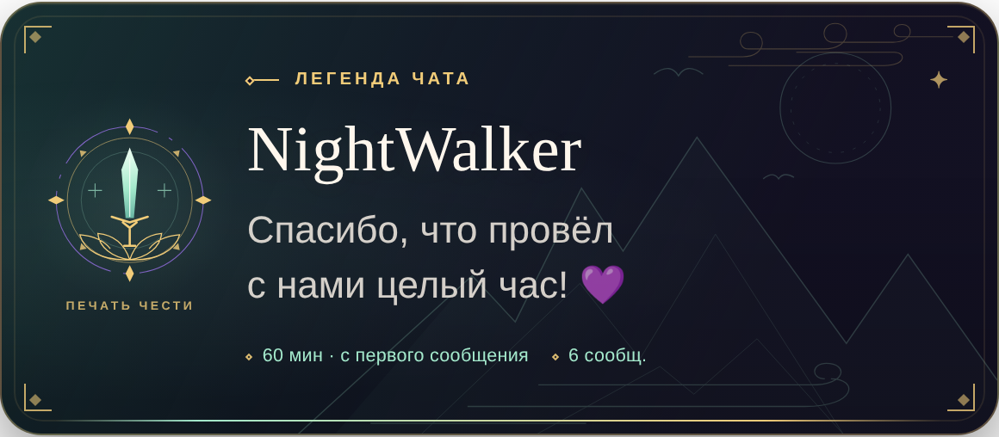

# Оформление в стиле дунхуа

Фэнтезийная тема в духе сянься: нефритовый меч, лотос и орбитальная печать, тонкая золотая рамка, облачные линии, тушевые горы и луна. Имя зрителя выделено крупным шрифтом с засечками; остальной текст остаётся русским и читаемым.

## Как получить оформление

Тема опубликована в `widget/HTML.html` и `widget/CSS.css`. При установленном новом AUTOUPDATE.js (загрузка HTML/CSS/JS) она приходит автоматически при очередной проверке, обычно в течение пяти минут, после завершения текущей очереди. Чтобы получить её сразу, обновите оверлей. FIELDS, DATA и прогресс менять не нужно.

Старый загрузчик только JavaScript не загружает новую тему: его нужно один раз заменить по [инструкции](AUTOUPDATE.md). В ручном режиме скопируйте обновлённые HTML.html и CSS.css в соответствующие вкладки, сохраните и обновите виджет.

## Настройки и производительность

Размер шрифта, ширина, скругление, положение, текст и длительность по-прежнему задаются существующими FIELDS. Основной цвет управляет внешней орбитой печати, дополнительный — золотым обрамлением и заголовком, цвет фона — основой тёмной плашки, цвет текста — именем и благодарностью. Нефритовый меч и дымчатые горы — детали темы с собственным мягким оттенком; сохранённые пользовательские цвета не сбрасываются.

Частицы отключаются прежним полем. Орнаменты — встроенные SVG, внешние шрифты не используются. При включённых аватарках дополнительно загружается портрет получателя из Twitch CDN через публичный DecAPI; при ошибке остаётся векторная печать. Градиенты, горы и орнаменты статичны. Во время показа двигаются только transform и opacity: выезд, короткое появление печати, восемь лёгких частиц и линия длительности. При reduced motion выезд заменяется появлением через прозрачность, частицы и анимация печати отключаются.

Проверены обычная плашка, ширина 280 px с длинным кириллическим именем, отсутствие горизонтального переполнения, последовательный показ наград и применение новой HTML/CSS через загрузчик с сохранением сессии. Фактическая плавность в конкретной сцене OBS зависит от компьютера пользователя.

## Утверждённые настройки заголовка и эмблемы

В FIELDS доступны «Шрифт заголовка „ЛЕГЕНДА ЧАТА“» (шесть системных семейств) и «Пауза перед эмблемой после появления плашки» (по умолчанию 0,25 с). Сначала завершается выезд плашки, затем эмблема с мечом мягко проявляется за 0,45 с. Анимация повторяется при каждой благодарности. Для отображения новых контролов один раз обновите FIELDS, сохранив текущий DATA. Подробнее: [Настройки](SETTINGS.md).

## Размеры трёх строк

Для заголовка, имени зрителя и фразы благодарности добавлены независимые регуляторы. Начальные значения: 12, 38 и 22 px соответственно. Чтобы увидеть слайдеры в существующем виджете, обновите FIELDS, сохраните и обновите оверлей; текущий DATA оставьте. До обновления полей старый масштаб текста сохраняется.

## Портрет вместо печати

По умолчанию место печати занимает круглая Twitch-аватарка получателя, с золотой рамкой и той же задержкой. Подпись меняется на «ГЕРОЙ ЧАТА». При недоступности портрета возвращаются печать и её подпись. Новое поле avatarEnabled позволяет выбрать прежнее оформление. Подробнее: [Аватарки](AVATARS.md).
